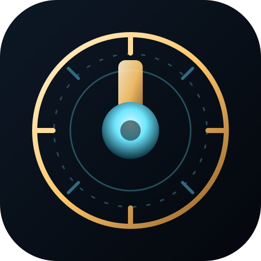

# Time Architect

**Rewind, pause and fast-forward individual objects to solve deterministic puzzle chambers.**
By [nRnWorld](mailto:bynrnworld@gmail.com) — commercial licensing contact: <bynrnworld@gmail.com>

Time Architect is a complete, handcrafted puzzle campaign set in clockwork chambers. Every step
you take advances the chamber clock by one tick. Dials hold gates and bridges open; drones sweep
the galleries. You can rewind, freeze, play or accelerate any object, but only one moment can be
held still at a time.



## What is in this repository

- **A complete 12-chamber campaign** with a tutorial curve, finale and ending.
- **A deterministic simulation** shared by the game, the tests and an automated solver.
- **An original isometric renderer** drawn procedurally on canvas — no game engine, no image packs.
- **Seven languages** (English, Swedish, Turkish, Spanish, Arabic with full RTL, French, Japanese),
  with local flag assets and per-app language persistence.
- **Offline-first PWA and native apps**: an installable web build, plus Capacitor 7 Android and iOS
  projects wired to the same `dist/` bundle. Signed release builds are documented and reproducible.
- **Accessibility**: reduced motion, high contrast, larger touch targets, color-independent signals,
  keyboard and gamepad support, free undo, scalable UI, RTL layout.
- **No ads, no analytics, no accounts, no network calls at runtime.**
- **Store-ready identity**: adaptive icon, splash, edge-to-edge layout, application id
  `com.nrnworld.timearchitect`, target SDK 36, version 1.1.0, official nRnWorld studio mark in
  Credits and a full inline SVG icon set.
- **Native manners**: the Android back gesture pauses instead of quitting, haptics are permitted,
  and the service worker never serves a previous release after an update.

The campaign can be verified automatically: `npm test` proves that each chamber is solvable,
that its par is correct, and that it cannot be solved without manipulating time.

## Quick start

Requirements: Node.js 20 or newer (tested on Node 24).

```bash
npm run dev          # http://127.0.0.1:4173
npm test             # simulation, campaign, solver, i18n and asset tests
npm run solve        # solvability + par + "time control is required" report
```

Android and iOS:

```bash
npm install
npm run android:debug     # debug APK -> android/app/build/outputs/apk/debug/
npm run android:bundle    # Play-ready AAB (signed when keystore.properties exists)
npm run ios:sync          # copy the web build into the Xcode project (build on macOS)
```

The web build alone has no build step and no runtime dependency.

## Controls

| Action | Keyboard | Touch / pointer |
| --- | --- | --- |
| Walk | Arrows or WASD | Swipe, or the on-screen pad |
| Wait one tick | Space | Centre button of the pad |
| Undo a step | Z / Backspace | Undo button |
| Restart chamber | R | Restart button |
| Pause | Esc / P | Pause button |
| Select object | Tab / Q / E | Tap the dial or drone, or the object strip |
| Rewind / freeze / play / fast | 1 / 2 / 3 / 4 | Time buttons |
| Show hint | H | `?` button |

Gamepad: D-pad or left stick to walk, A wait, B undo, X select next, Y pause, LB/RB time.

## Rules

1. Moving or waiting advances every clock by its rate. Setting a rate costs no time.
2. Only one object may be paused at a time.
3. A gate or bridge that closes while you stand on it unmakes you. Freeze a span open, or cross it
   within one continuous window.
4. Drones unmake you on contact and block the tile they occupy.
5. Collect every anchor to restore the chamber. Undo is always free.

## Project layout

```
index.html              app shell
styles.css              responsive UI, RTL, accessibility themes
src/core/               deterministic simulation, levels, solver, save, audio, input, i18n
src/render/scene.js     isometric canvas renderer and effects
src/ui/screens.js       screens, HUD templates, modals
src/data/levels.js      12 handcrafted chambers
src/data/locales/       seven complete translations
assets/flags/           public-domain flag SVGs (see THIRD_PARTY_NOTICES.md)
assets/icon.png         generated app icon and splash (tools/make-icons.py)
android/                Capacitor Android project (Gradle, signing, icons)
ios/                    Capacitor iOS project (Xcode, AppIcon, splash)
tests/                  simulation, campaign, solver, localization
tools/solve.mjs         campaign verification report
tools/route.mjs         prints the exact action sequence for a chamber (QA replay)
tools/build-web.mjs     assembles dist/ with a hashed cache name
docs/                   art bible, store copy, monetization
```

## Documentation

- [ARCHITECTURE.md](ARCHITECTURE.md) — code structure, data flow, determinism, persistence
- [PLAN.md](PLAN.md), [TASKS.md](TASKS.md), [RISK_REGISTER.md](RISK_REGISTER.md)
- [ACCEPTANCE_CRITERIA.md](ACCEPTANCE_CRITERIA.md), [RELEASE_REPORT.md](RELEASE_REPORT.md)
- [BUILDING.md](BUILDING.md), [RELEASE_CHECKLIST.md](RELEASE_CHECKLIST.md), [HUMAN_ACTIONS.md](HUMAN_ACTIONS.md)
- [docs/ART_BIBLE.md](docs/ART_BIBLE.md), [docs/STORE_LISTING.md](docs/STORE_LISTING.md),
  [docs/MONETIZATION.md](docs/MONETIZATION.md)
- [PRIVACY.md](PRIVACY.md), [SECURITY.md](SECURITY.md), [CONTRIBUTING.md](CONTRIBUTING.md)
- [THIRD_PARTY_NOTICES.md](THIRD_PARTY_NOTICES.md), [LICENSE](LICENSE), [CHANGELOG.md](CHANGELOG.md)

## Status

The campaign is complete and verified, and it now ships in a native shell:

| Artifact | State |
| --- | --- |
| Web / PWA | Complete, browser-verified at 950×987 and 390×844 |
| Android debug APK | Built, installed and played on a Pixel 8 Pro emulator (API 35) |
| Android release AAB | Built (`5.5 MB`), **unsigned** until the owner supplies a keystore |
| iOS project | Prepared and iconed; **not built** (requires macOS + Xcode) |
| Store accounts, keystore, purchases | Not created — see [HUMAN_ACTIONS.md](HUMAN_ACTIONS.md) |

The game is deliberately free of ads, analytics and network calls. A revenue design (a $3.99
Full Campaign unlock plus a $1.99 cosmetic pack) is specified in
[docs/MONETIZATION.md](docs/MONETIZATION.md); no billing SDK is wired yet, so the shipped build is
fully unlocked. Exact evidence and limitations are in [RELEASE_REPORT.md](RELEASE_REPORT.md).

## License

Source-available for non-commercial educational use. Sale, monetized distribution, ad-supported
reuse, sponsorship and paid client work require written permission from bynrnworld@gmail.com.
See [LICENSE](LICENSE) (SPDX: `LicenseRef-nRnWorld-Educational-1.0`). This license is not
OSI-approved; legal review is recommended before release.

**By nRnWorld**
